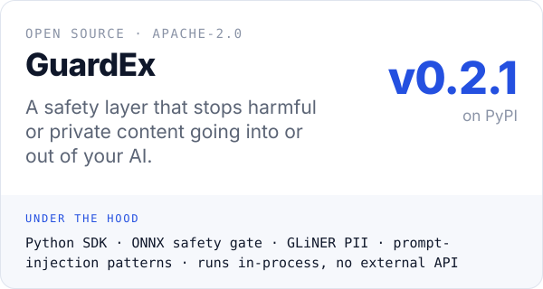
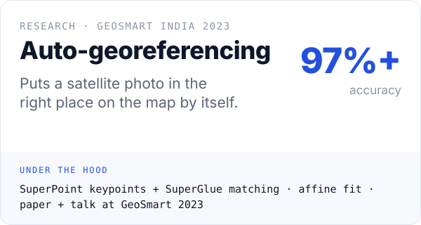
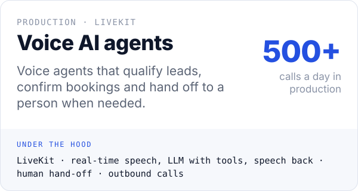
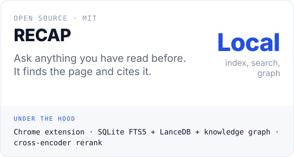
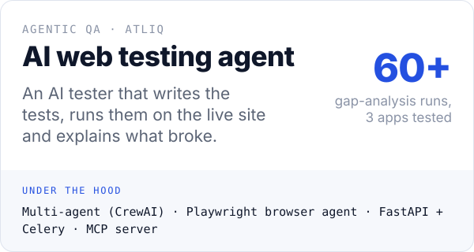
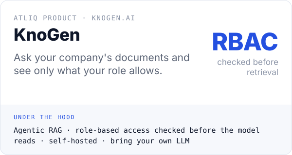
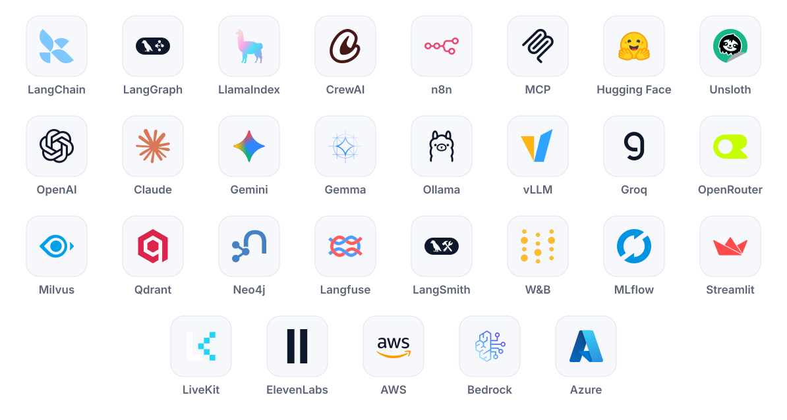
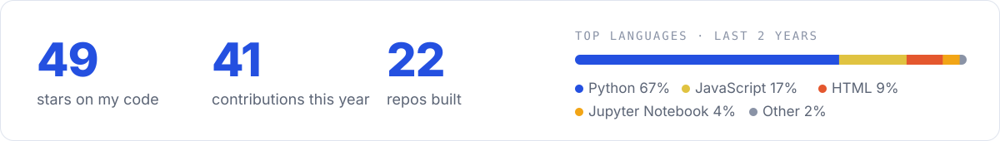

<picture>
  <source media="(prefers-color-scheme: dark)" srcset="assets/header-dark.svg">
  
</picture>

  
  
  
  
  

I build production AI at **AtliQ Technologies** and teach it at **Codebasics** and on **YouTube**.

## Shipped work

<a href="https://github.com/atliq/guardex-ai"><picture><source media="(prefers-color-scheme: dark)" srcset="assets/card-guardex-dark.svg"></picture></a>
<a href="https://srikanthdongala.pages.dev/papers/geosmart-2023-auto-georeferencing.pdf"><picture><source media="(prefers-color-scheme: dark)" srcset="assets/card-georef-dark.svg"></picture></a>
<a href="https://srikanthdongala.pages.dev/#work"><picture><source media="(prefers-color-scheme: dark)" srcset="assets/card-voice-dark.svg"></picture></a>
<a href="https://github.com/atliq/recap"><picture><source media="(prefers-color-scheme: dark)" srcset="assets/card-recap-dark.svg"></picture></a>
<a href="https://srikanthdongala.pages.dev/#work"><picture><source media="(prefers-color-scheme: dark)" srcset="assets/card-qa-dark.svg"></picture></a>
<a href="https://www.knogen.ai/"><picture><source media="(prefers-color-scheme: dark)" srcset="assets/card-knogen-dark.svg"></picture></a>

## Run my code

- [**mini-claude**](https://github.com/Srikanthdongalajsr/mini-claude): build your own Claude Code in plain Python
- [**blipkart-agent-evals-guardrails**](https://github.com/Srikanthdongalajsr/blipkart-agent-evals-guardrails): an agent with guardrails, evals and tracing
- [**llm-cost-cutting**](https://github.com/Srikanthdongalajsr/llm-cost-cutting): five ways to cut an LLM bill
- [**embeddinggemma-2-tutorial**](https://github.com/Srikanthdongalajsr/embeddinggemma-2-tutorial): search photos, audio and text with one model

## Languages and tools

<picture>
  <source media="(prefers-color-scheme: dark)" srcset="assets/ai-stack-dark.svg">
  
</picture>

<picture>
  <source media="(prefers-color-scheme: dark)" srcset="https://skillicons.dev/icons?i=python,pytorch,tensorflow,sklearn,opencv,fastapi,docker,sqlite,cloudflare,githubactions,git,linux&theme=dark">
  
</picture>

<picture>
  <source media="(prefers-color-scheme: dark)" srcset="assets/stats-dark.svg">
  
</picture>

## Teaching

Instructor at [Codebasics](https://codebasics.io/bootcamps/ai-engineering-bootcamp-software-engineers-4) · speaker at GDG Baroda, AI Day 2026, GeoSmart 2023 · 50+ engineers mentored

<!-- VIDEOS:START -->

<!-- VIDEOS:END -->

Building something with AI? <a href="https://srikanthdongala.pages.dev">Let's work together.</a>

